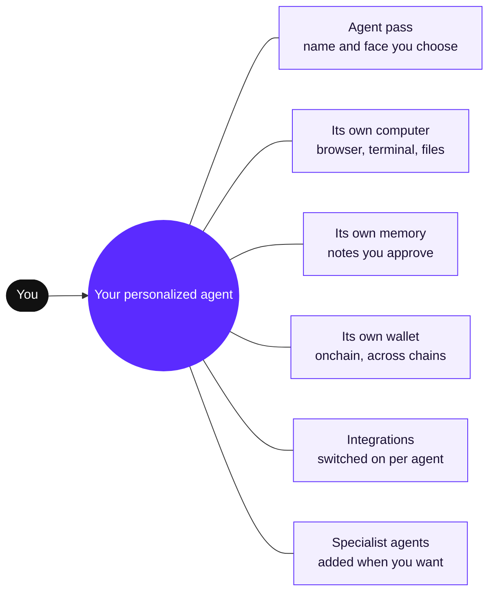
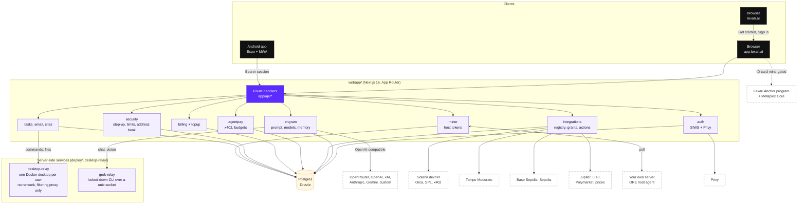
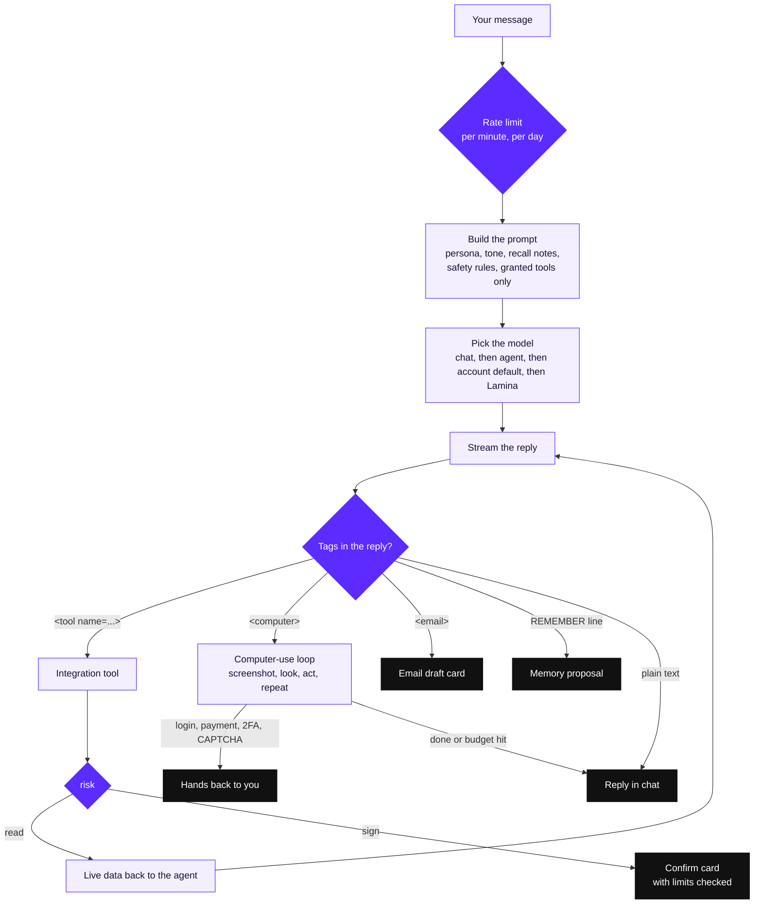
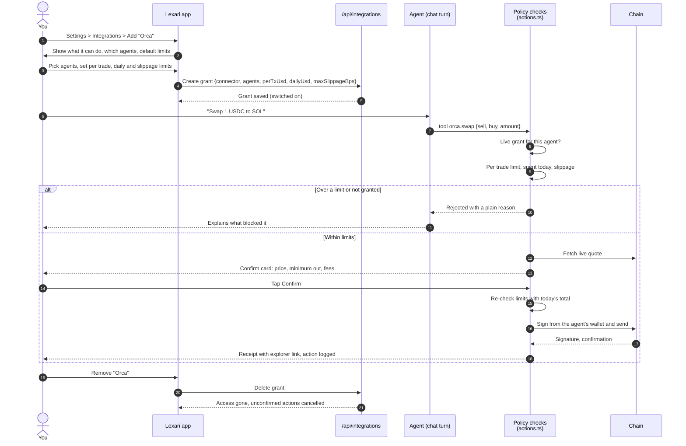
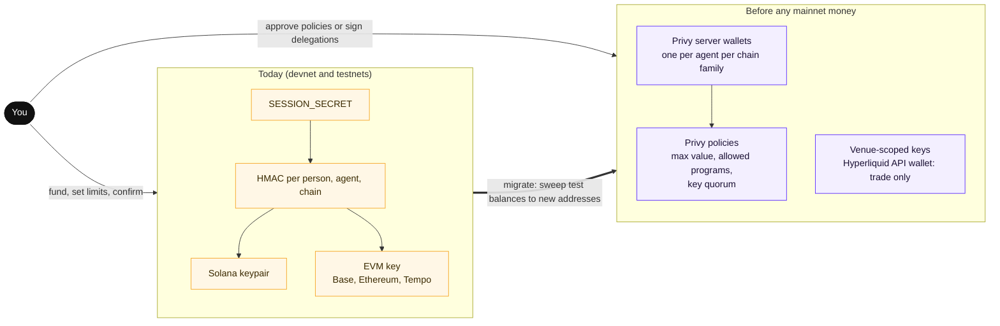
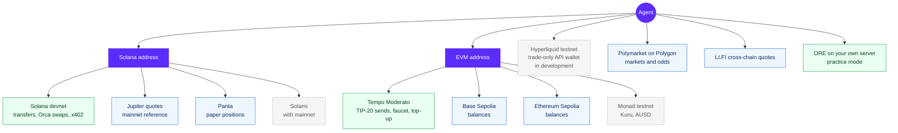
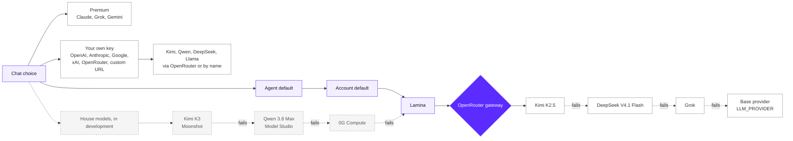

<div align="center">


# Lexari

### Meet your own personalized AI agent.

**Your own AI agent, with its own memory, wallet and computer, that you personalize and that acts for you onchain and across apps.**<br/>
Sign in with Google or email, give it a name and a face, and tell it what you need. Add specialist agents when you want more help.

<br/>

[](https://app.lexari.ai)
[](https://lexari.ai)
[](https://github.com/xElvolution/lexari-web)


[Concept](#-meet-your-own-personalized-ai-agent) ·
[Features](#-features-and-status) ·
[Architecture](#-system-architecture) ·
[Wallets](#-wallet-and-custody-model) ·
[Chains](#-multi-chain-map) ·
[Models](#-model-router) ·
[Mobile](#-mobile) ·
[Security](#-security-model) ·
[Run it](#-getting-started) ·
[Roadmap](#-roadmap)

</div>

---

> [!IMPORTANT]
> **Lexari is a testnet product.** Everything that moves value runs on Solana devnet, Tempo Moderato testnet or other testnets, with test tokens. Nothing in this repository moves real money today. This README separates what is **live in the code now** from what is **in progress** and what is **on the roadmap**, and each claim was checked against the source.

<br/>

## ◆ The problem

AI assistants today are tabs, not teammates.

- **They forget.** Every chat starts from zero, so you repeat your preferences, your context and your rules.
- **They have no hands.** They can describe a website, a spreadsheet or a swap, but they cannot open a browser, run a command or hold a balance.
- **When they do get hands, you lose control.** "Agent wallets" usually mean a hot key with unlimited reach, and plugins usually mean blanket access with no limits, no log and no off switch.
- **Crypto is fragmented.** Every chain, venue and model has its own wallet, key, SDK and login. A normal person cannot wire all of that together safely.

## ◆ The solution

Lexari gives you a personalized AI agent: your own agent, not a shared chatbot. It keeps its own memory, holds its own wallet, works on its own computer, and acts for you onchain and across apps, inside the limits you set.

| A generic AI assistant | Your personalized Lexari agent |
| --- | --- |
| Anonymous and interchangeable | A generated face, a name you choose and an agent pass ID card |
| No computer of its own | Its own sandboxed Linux desktop with a browser and a terminal |
| Forgets you every session | A memory that lasts, built from notes it proposes and you keep |
| No money, or a hot key with unlimited reach | Its own onchain wallet, with per-trade and daily limits you set |
| Blanket plugin access | Integrations you switch on per agent, with a Confirm card for every signed action |
| Acts on its own terms | Acts for you. Every money action waits for your tap, unless it fits a budget you opted into |

<br/>

## ◆ Meet your own personalized AI agent



- **The agent pass.** Every agent has a face generated in code from parts (shape, eyes, mouth, extras) in the brand palette. A seed always produces the same face. The pass swings on a spring pendulum on the landing page.
- **Its computer.** Each person gets one locked-down Docker desktop. Your agent acts there by looking at screenshots and acting with the mouse and keyboard, and you can watch the screen or take over.
- **Its memory.** At the end of a reply the agent can propose one line to remember. It is a proposal, not a saved memory, until it is kept. You can browse and delete memories in Brain.
- **Its wallet.** Each agent has its own onchain address per chain family. You fund it, you set its limits, and you approve its sends.
- **Specialists.** Next to your personalized agent you can add house specialist agents from the marketplace, including the free **ORE Miner**.

<br/>

## ◆ Features and status

**Legend:** 🟢 Live in the code now (devnet or testnet) · 🟡 In progress or partial · ⚪ Roadmap (not built)

### Core product

| Feature | Status | Notes |
| --- | :---: | --- |
| Landing site (`lexari.ai`) | 🟢 | Separate Next.js app. GSAP scroll scenes, draggable agent pass, roster, agent floor plan |
| Web app (`app.lexari.ai`) | 🟢 | Agents, chat, Hub, marketplace, team, brain, wallets, settings |
| Google and email sign-in (Privy) | 🟢 | Privy creates an embedded Solana wallet that signs the same sign-in message a wallet user signs |
| Solana wallet sign-in (Phantom, Solflare, Backpack) | 🟢 | Sign-In With Solana: nonce, signature, httpOnly session cookie |
| Streaming chat with your agent | 🟢 | `POST /api/chat`, per-user rate limits |
| Memory notes | 🟢 | Agent proposes, you keep or delete. Stored per user |
| Face creator and generated avatars | 🟢 | SVG from seeded parts, shared by web and mobile |
| Agent computer (desktop, browser, terminal, files) | 🟢 | One container per user through `desktop-relay/`. Computer-use loop with a step and time budget and a Stop button |
| Publish a site the agent built | 🟢 | Served at `app.lexari.ai/p/<id>/` with a sandbox CSP |
| Agent email | 🟢 | Each agent gets an inbox. Outgoing mail is a draft card that only sends when you tap Send |
| Tasks and schedules | 🟢 | Hourly, daily, weekday and weekly runs in your timezone |
| Voice calls with an agent | 🟢 | Browser speech-to-text and text-to-speech, with interruption handling |
| Secrets vault | 🟢 | AES-256-GCM sealed values. Agents only see names |
| Marketplace specialists | 🟢 | House specialists added for 0.01 SOL on devnet, verified from the confirmed transaction |
| Hub (check-in, quests, mystery box, levels, referrals) | 🟢 | Runs offchain in Postgres today, with race-safe claims |
| Billing and top-up | 🟢 | Plans and credits. Deposits verified on Solana devnet and EVM, Tempo, Bitcoin, Litecoin, Tron and XRPL testnets |
| Rename your agent from its profile | 🟢 | Nickname and notes on the agent panel |
| Agent manages itself by chat (rename, face, tone, model) | 🟢 | A built-in `self` connector: every change is a Confirm card, applied only on your Confirm and kept in the audit log. Never from email or web content it read. The agent can never change its own grants, limits, wallets or keys |
| Onchain agent ID card (Metaplex Core + Lexari program) | 🟡 | Mint flow is built and gated: it switches on once the Lexari program is deployed to devnet |
| Lexari Anchor program | 🟡 | Agent registry, memory records, Hub PDAs. Built with tests. Devnet deploy pending (rent for a ~416 KB program) |
| ORE Miner gift reveal after your agent is created | ⚪ | Today the ORE Miner is a free specialist in the marketplace. The wrapped gift flow is designed, not built |
| Agent payment card | 🟡 | `CardIssuer` interface plus a TEST-only issuer (4242 numbers that work nowhere). Stripe Issuing or Lithic later |

### Integrations

Every integration is **off until you add it**, granted to specific agents, and bounded by limits. Read tools return data. Sign tools prepare a Confirm card.

| Integration | Chain | Read | Act | Status |
| --- | --- | :---: | :---: | :---: |
| Solana wallet and transfers | Solana devnet | 🟢 | 🟢 send SOL or test USDC after Confirm | 🟢 |
| Orca Whirlpools | Solana devnet | 🟢 live quotes | 🟢 SOL / USDC swaps after Confirm | 🟢 |
| Jupiter | Solana mainnet (quotes) | 🟢 | ⚪ swaps | 🟢 read only |
| Cross-chain quotes (LI.FI) | Solana, Ethereum, Base, Arbitrum, Bitcoin and more | 🟢 | ⚪ bridging | 🟢 read only |
| Polymarket | Polygon | 🟢 markets and odds | ⚪ orders | 🟢 read only |
| Panta prediction markets | Solana | 🟢 | 🟡 paper positions on devnet: open at a real quote, marked to live prices, closed with profit and loss after Confirm (built and tested; stays 🟡 until a Panta API key is set) | 🟡 needs API key |
| Tempo | Moderato testnet (42431) | 🟢 pathUSD, AlphaUSD | 🟢 faucet, sends, top-ups after Confirm | 🟢 |
| Base | Base Sepolia | 🟢 balances | 🟢 transfers (ETH, test USDC) and Uniswap v3 swaps, after Confirm | 🟢 |
| Ethereum | Sepolia | 🟢 balances | 🟢 transfers (ETH, test USDC) and Uniswap v3 swaps, after Confirm | 🟢 |
| Market prices | Any | 🟢 | n/a | 🟢 |
| Agent payments (x402, agent to agent requests) | Solana devnet | 🟢 | 🟢 auto inside budget, Confirm above it | 🟢 |
| ORE mining | Your own server | 🟢 | 🟢 install, start, stop, watch (practice mode, no rewards) | 🟢 |
| Solami (RPC, webhooks, Beam) | Solana mainnet | ⚪ | ⚪ | ⚪ arrives with mainnet |
| Hyperliquid (trade-only API wallet, perps) | Hyperliquid testnet | 🟢 prices, positions, orders | 🟢 market and limit orders after Confirm | 🟢 |
| Monad (Kuru, AUSD, Nansen data) | Monad testnet | 🟢 MON balance; 🟡 Nansen wallet reads and Kuru routes (need API keys) | 🟡 Kuru swaps after Confirm (need the Kuru API and router); 🟢 AUSD balance, faucet, pay and cross-border sends after Confirm | 🟡 |
| Tempo agent card | Tempo testnet | 🟢 balance, limits, history | 🟢 merchant payments in stablecoins after Confirm, per payment and daily limits, freeze | 🟢 web and phone |

### Models

| Capability | Status | Notes |
| --- | :---: | --- |
| **Lamina**, Lexari's house model | 🟢 | A routed model: Kimi K2.5 first, then DeepSeek V4.1 Flash, then Grok, then the server's base provider |
| Premium models (Claude, Grok, Gemini) | 🟢 | Through the OpenRouter gateway when a key is configured |
| Bring your own key | 🟢 | OpenAI, Anthropic, Google, xAI, OpenRouter, plus a custom OpenAI-compatible base URL |
| Kimi and Qwen on your own key | 🟢 | Via the OpenRouter provider (`moonshotai/kimi-k3`, `qwen/qwen3.8-flash`) or any model added by name |
| Kimi K3 and Qwen 3.8 Max as house models | 🟢 | Live in the model picker on Lexari's own Moonshot and Alibaba Model Studio keys, each with a fallback chain. Kimi K2.5 already powers Lamina |
| 0G Compute router | 🟢 | A house provider on the 0G Compute Router (OpenAI-compatible). Kimi, Qwen, OpenAI and Claude in the picker run through it with one `ZG_COMPUTE_API_KEY` (direct Moonshot and DashScope keys are optional overrides). Set on the production server and answering |
| Per-model fallback chains | 🟢 | Each house model has its own chain (Kimi, then Qwen, then OpenAI on 0G, then Lamina), tried only before any text reaches you. `HOUSE_FALLBACKS` reorders or empties a chain per model and `HOUSE_FALLBACK_LAMINA=0` turns off the Lamina last resort |
| Cost dashboard and per-agent model caps | ⚪ | Model router v2 |

<br/>

## ◆ System architecture



**Why one backend inside the web app.** Chat streams over a `ReadableStream`, sessions are httpOnly cookies on the app origin, and domain logic sits in `webapp/server/` so route files stay thin. A second service would split auth, CORS and deploys. Heavy or risky work (the desktop, the Grok CLI) runs in separate, locked-down processes that the app reaches over a socket or a signed ticket.

<br/>

## ◆ Agent runtime

What happens in one chat turn.



Two rules make this safe by construction:

1. **The agent only hears about integrations you added and granted to that agent.** It cannot call what it was never told exists, and the server rejects anything outside the grant.
2. **Anything the person did not type is data.** Web pages, emails, files, screenshots and tool output are read and summarized, never obeyed. The real enforcement (Confirm cards, budgets, limits) lives on the server, not in the prompt.

<br/>

## ◆ Integration permission and consent flow



Every action is a row in `integration_actions` with its state (`submitting`, `submitted`, `confirmed`), so "spent today" counts real attempts and nothing pays twice. Agent payments to x402 services and other agents are the one class that can run on their own, and only inside a budget you set; above it they become a Confirm card.

**Planned upgrades:** declared scopes per integration shown in the consent sheet, grant expiry, token and market allowlists, transaction simulation before EVM signs, and a "freeze all agents" kill switch.

<br/>

## ◆ Wallet and custody model

Lexari keeps three kinds of wallets apart.

| Wallet | Who holds the key | Used for | Status |
| --- | --- | --- | :---: |
| **Your wallet** | You (Phantom, Solflare, Backpack, Seed Vault through MWA) or Privy's embedded wallet for Google and email accounts | Sign-in, specialist purchases, top-ups, funding your agents | 🟢 |
| **Agent wallets** | The Lexari server, derived per person, agent and chain | The agent's own trades, sends and payments within your limits | 🟢 testnets only |
| **Lexari treasury and payout** | Lexari | Receives specialist purchases and top-ups, pays out devnet test USDC | 🟢 devnet |



> [!WARNING]
> **Honest custody note.** Agent keys today are derived from `SESSION_SECRET`, so no key is stored, but a leak of that one secret would expose every agent wallet, and rotating it would move every address. That is acceptable for devnet and testnet test tokens and **not acceptable for real money**. Mainnet is paused until agent keys move to policy-bound signing (see [Security model](#-security-model)).

<br/>

## ◆ Multi-chain map

Your agent has one balance, like any app, and Solana is its home. Chains are routes, not accounts: when a trade or payment needs funds elsewhere, the agent proposes one Confirm card that moves them through Aurora Intents and then runs the trade. Nothing signs without your Confirm.

Lexari is chain-agnostic by design: an agent has one Solana address and one EVM address that is the same on every EVM chain, and each integration declares which chains it touches.



**Legend:** green is live and can move test value · blue is live and read only · grey dashed is in development or on the roadmap.

Top-ups (paying Lexari for plans and credits, separate from agent wallets) accept deposits on Solana devnet and on Ethereum, Base, Arbitrum, BNB Chain, Tempo, Bitcoin, Litecoin, Tron and XRP Ledger testnets.

<br/>

## ◆ Model router



- **One tool format for every model.** Tools are text tags, so any model in the catalog can drive the agent, including models you add by name.
- **Your keys stay yours.** BYO keys are sealed server-side; only the last four characters ever reach the browser. BYO usage is never billed by Lexari.
- **Privacy default.** The OpenRouter pool defaults to providers that do not keep prompts (`OPENROUTER_DATA_COLLECTION=deny`).
- **Next (router v2):** a provider table with house and BYO entries, per-model fallback chains that never fall back to a model without tool support mid-loop, a `model_usage` ledger, and per-agent monthly caps.

<br/>

## ◆ Mobile

`android-app/` is a native **Expo** app for Android, built for Solana Mobile and any Android phone. It has its own `package.json` and is not part of the root workspaces.

| Area | Status | Notes |
| --- | :---: | --- |
| Sign in with **Mobile Wallet Adapter** | 🟢 | Seed Vault on Seeker and Saga, Phantom and Solflare on any Android |
| Sign in with Google or email (Privy) | 🟢 | When the build has a Privy app id and client id |
| Session in SecureStore, Bearer auth to the same API | 🟢 | `POST /api/auth/verify?client=mobile` |
| App lock | 🟢 | Fingerprint or Face ID plus a 6-digit PIN, backoff after wrong tries |
| Hub, agents, chat, Confirm cards, wallets, marketplace, team, brain | 🟢 | Same backend as the web app |
| Calls and the agent computer on the phone | 🟢 | |
| SKR top-up | 🟢 | Devnet |
| Testnet banner | 🟢 | "TESTNET, not real money" on every preview build |
| Push notifications (FCM) | 🟡 | Code is in place. Needs the operator's `google-services.json` |
| Solana dApp Store listing | ⚪ | |

Package ids `ai.lexari.app.testnet` (preview) and `ai.lexari.app` (production), deep link scheme `lexari://`. The app targets devnet only; mainnet is paused.

<br/>

## ◆ Security model

| Layer | What it does | Status |
| --- | --- | :---: |
| **Sign-in** | Wallet signs a nonce bound to `LEXARI_APP_ORIGIN`. Privy users sign the same message with their embedded wallet. httpOnly HMAC session cookie | 🟢 |
| **Confirm cards** | Every signed integration action and every email waits for your tap | 🟢 |
| **Limits** | Per integration: per trade, daily and slippage. Account wide: a daily money limit across agent sends, trades, payments and wallet sends | 🟢 |
| **Step-up** | Big or first-time sends, new API keys, raised budgets and changed email forwarding need a fresh PIN (or wallet signature), valid 5 minutes on that device | 🟢 |
| **Address book** | First-time addresses get a warning. "Saved addresses only" blocks the rest | 🟢 |
| **Anti-phishing phrase** | Shown on every sensitive sheet | 🟢 |
| **Sessions and log** | See and sign out devices, security log, new-device alerts | 🟢 |
| **Prompt-injection rules** | Only your own messages are instructions. Seed phrases and private keys are blocked in chat | 🟢 |
| **Secrets vault** | AES-256-GCM, bound to user and row, never logged, never sent to the browser or a prompt. Injected as env vars at exec time and scrubbed from output | 🟢 |
| **Agent desktop isolation** | Docker with `--network none`, seccomp, disk quotas and write caps. The browser reaches only the public web through a filtering proxy that refuses private, loopback and host addresses | 🟢 |
| **Outbound fetch guard** | Server fetches go through `safeFetch` (blocks private networks) | 🟢 |
| **Published sites** | Served with `Content-Security-Policy: sandbox`, an opaque origin with no access to Lexari cookies | 🟢 |
| **ORE Miner** | Never mines on Lexari machines. One-time install code, hashed host token, uninstall on removal | 🟢 |
| **Agent key custody** | HMAC-derived keys today (testnets only) | 🟡 |
| **Policy-bound signing** | Trade-only venue keys are live. Privy server wallets with policies are next | 🟡 |
| **Transaction simulation** | Every EVM send, Uniswap swap and AUSD payment is simulated (eth_simulateV1) before its Confirm card exists; the card shows your balance change and the fee, and a call that would revert never becomes a card | 🟢 |
| **Withdraw only to linked wallets, freeze all agents** | Consent with scopes, limits and expiry, audit log, revoke and switch off all | 🟢 |

### Custody migration plan

1. **Now:** testnet only, HMAC-derived agent keys, every send behind a Confirm card, limits and step-up.
2. **Before mainnet:** move each agent to a **Privy server wallet** per chain family with **Privy policies** (max value, allowed programs and contracts, key quorum). Sweep test balances to the new addresses.
3. **Venues:** scoped keys where the venue supports them, such as Hyperliquid API wallets that can trade but cannot withdraw.
4. **Linked wallets:** withdrawals allowed only to wallets you linked, and a kill switch that revokes every grant at once.

<br/>

## ◆ Tech stack

| Layer | Technology |
| --- | --- |
| Web and landing | Next.js 16 (App Router), React 19, Tailwind CSS 4, GSAP, three.js |
| Type and brand | Bricolage Grotesque, Figtree, Martian Mono. Black, purple `#5b2bff` and white, light and dark themes |
| Backend | Next.js route handlers, Drizzle ORM, Postgres (`postgres`), Zod, jose |
| Auth | Privy (`@privy-io/react-auth`, `@privy-io/expo`), Sign-In With Solana, Solana wallet adapters |
| Solana | `@solana/web3.js`, SPL Token, Anchor 0.32, Metaplex Core and Umi, Orca Whirlpools SDK, Helius RPC |
| EVM and Tempo | `@noble/curves`, `@noble/hashes`, raw EIP-1559 (web), viem (mobile) |
| Agent computer | Docker, x11vnc, noVNC, xterm.js, node-pty, openbox |
| Models | OpenRouter gateway, OpenAI-compatible APIs, xAI, Grok CLI relay |
| Mobile | Expo 57, React Native 0.86, Expo Router, Reanimated, Mobile Wallet Adapter, SecureStore, local authentication |
| Notifications | Web Push (VAPID), Expo push |
| Deploy | pm2, zero-downtime release script with smoke tests and rollback, systemd units for the relays |
| Tests | `tsx --test` unit suites, API script, Anchor tests |

<br/>

## ◆ Repository structure

```text
lexari-web/
├── landing/                 Marketing site and legal pages (Next.js, :3000)
│   ├── app/                 Routes, OG image, legal/[slug]
│   ├── components/          Agent pass pendulum, desktop, memory cards, roster, floor plan
│   └── content/             Every landing word (copy.ts, legal.ts)
├── webapp/                  The product and its API (Next.js, :3001)
│   ├── app/
│   │   ├── (app)/           agents, brain, hub, marketplace, profile, settings, team, wallets
│   │   ├── api/             auth, chat, integrations, computer, desktop, email, tasks,
│   │   │                    billing, topup, hub, miner, models, secrets, security, x402, ...
│   │   ├── onboarding/      Agent setup
│   │   ├── signin/          Google, email and wallet sign-in
│   │   └── p/[id]/          Sites your agent published
│   ├── components/          UI by feature (agent, integrations, wallet, miner, security, ...)
│   ├── content/             Catalogs: integrations, models, billing, topup, appData
│   ├── lib/                 Client helpers: chain, hub, voice, calls, vault
│   └── server/
│       ├── auth/            SIWS, Privy, sessions
│       ├── engram/          Prompt (spinal), model routing (cortex, gateway, byo), memory (hippocampus)
│       ├── integrations/    Tool registry, grants, actions, Solana, EVM, Tempo, markets, bridge
│       ├── agentpay/        x402 buyer and seller, agent budgets
│       ├── billing/ topup/  Plans, credits, deposit verification
│       ├── security/        Step-up, limits, address book, device checks
│       ├── tasks/ email/    Schedules, meetings, sites, agent mail
│       ├── miner/           ORE host agent and host tokens
│       ├── hub/             Offchain Hub, attestor
│       └── db/              Drizzle schema and SQL migrations
├── android-app/               Expo Android app (own package.json)
│   ├── app/                 (auth), (tabs), agents, chat, call, desktop, settings
│   └── src/                 lib (MWA, Privy, session, lock), components, theme, brain
├── shared/                  Faces, logo, theme, badge copy and ID backgrounds for both web apps
├── contracts/solana/        Anchor program: agent registry, memory records, Hub PDAs, tests
├── contracts/evm/          Foundry: agent registry, spend vault, skills registry (Monad testnet deployments)
├── desktop-relay/           Per-user locked-down desktop containers and their relay
├── deploy/                  Release script, pm2 config, Grok relay and its systemd unit
└── scripts/                 Dev runner and the phone-width type generator
```

<br/>

## ◆ Getting started

### Prerequisites

- Node.js 20 or newer and npm
- Postgres (any local instance or a hosted URL)
- Optional: Docker (agent computer), the Anchor CLI and Solana CLI (program tests), Expo and EAS (mobile)

### Web app and landing

```bash
git clone https://github.com/xElvolution/lexari-web.git
cd lexari-web
npm install

cp .env.example webapp/.env.local      # then fill in the values you need
npm run db:migrate -w webapp           # apply SQL migrations

npm run dev                            # landing on :3000, web app on :3001
```

| Command | What it does |
| --- | --- |
| `npm run dev` | Starts landing (`:3000`) and webapp (`:3001`) together |
| `npm run dev:landing` | Landing only |
| `npm run dev:webapp` | Web app only |
| `npm run build` | Builds landing, then webapp |
| `npm start` | Serves both production builds |
| `npm run gen:type` | Regenerates `shared/styles/mobile-type.css` (smaller text sizes on narrow phone screens) |
| `npm run db:migrate -w webapp` | Runs the database migrations |
| `npm run test:unit -w webapp` | Unit tests (auth, billing, integrations, models, email, secrets, security, ...) |
| `npm run test:auth -w webapp` | Sign-In With Solana tests |
| `npm run test:api -w webapp` | API test script |

Without `DATABASE_URL` and `SESSION_SECRET`, sign-in and data routes return 503 and create no session.

### Mobile

```bash
cd android-app
npm install
npm test
npm run typecheck
npx expo start --web        # browser preview (PIN path works, no biometrics)
npx expo start --android    # dev build on a device or emulator
eas build -p android --profile preview   # installable testnet APK (needs an EAS account)
```

### Solana program

```bash
bash contracts/solana/scripts/test.sh
```

Use that script rather than plain `anchor test`: it loads the program with an upgrade authority so `init_config` can sign. Program id `BbnD28xf3kwfQRiRA6VQmw4p2R55WivUgozSoo81M6Po`.

### Environment variables

Names only. Copy `.env.example` to `webapp/.env.local` and never commit the filled-in file.

<details>
<summary><b>Web app</b> (<code>webapp/.env.local</code>)</summary>

| Group | Variables |
| --- | --- |
| Sites | `NEXT_PUBLIC_LANDING_URL`, `NEXT_PUBLIC_WEBAPP_URL`, `LEXARI_APP_ORIGIN`, `TRUST_PROXY`, `LEXARI_CSP` |
| Database and sessions (required) | `DATABASE_URL`, `SESSION_SECRET` |
| Solana | `NEXT_PUBLIC_SOLANA_CLUSTER`, `NEXT_PUBLIC_SOLANA_RPC`, `SOLANA_RPC`, `HELIUS_API_KEY`, `NEXT_PUBLIC_RPC_PROXY`, `NEXT_PUBLIC_LEXARI_PROGRAM_ID`, `LEXARI_ATTESTOR_KEY`, `ORCA_SOL_USDC_POOL`, `JUPITER_API_KEY` |
| Treasury, specialist purchases and payouts | `LEXARI_TREASURY`, `NEXT_PUBLIC_LEXARI_TREASURY`, `NEXT_PUBLIC_HIRE_LAMPORTS`, `NEXT_PUBLIC_HIRE_USD`, `NEXT_PUBLIC_HIRE_USDC`, `NEXT_PUBLIC_USDC_MINT`, `LEXARI_PAYOUT_KEY`, `LEXARI_FAUCET_KEY`, `FAUCET_DAILY_LAMPORTS`, `FAUCET_STEP_LAMPORTS`, `FAUCET_USER_CAP_LAMPORTS` |
| EVM and Tempo | `BASE_SEPOLIA_RPC`, `SEPOLIA_RPC`, `TEMPO_RPC` |
| Monad, Nansen, Kuru | `MONAD_RPC`, `NANSEN_API_KEY`, `NANSEN_API_URL`, `NEXT_PUBLIC_NANSEN_READY`, `KURU_API_URL`, `KURU_ROUTER_ADDRESS`, `KURU_TOKENS`, `NEXT_PUBLIC_KURU_READY` |
| Privy | `NEXT_PUBLIC_PRIVY_APP_ID`, `PRIVY_VERIFICATION_KEY`, `PRIVY_APP_SECRET`, `NEXT_PUBLIC_SOCIAL_LINKS` |
| Models | `LLM_PROVIDER`, `LLM_TIMEOUT_MS`, `OPENAI_API_KEY`, `OPENAI_BASE_URL`, `OPENAI_MODEL`, `XAI_API_KEY`, `XAI_BASE_URL`, `XAI_MODEL`, `OPENROUTER_API_KEY`, `OPENROUTER_BASE_URL`, `OPENROUTER_DATA_COLLECTION`, `MODEL_KEYS_SECRET`, `BYO_ALLOW_PRIVATE` |
| Grok CLI relay | `GROK_CLI_BIN`, `GROK_CLI_HOME`, `GROK_CLI_MODEL`, `GROK_CLI_CALL_MODEL`, `GROK_CLI_TIMEOUT_MS`, `GROK_CLI_CONCURRENCY`, `GROK_CLI_SOCKET` |
| Images | `LEXARI_IMAGE_GEN`, `LEXARI_IMAGE_COST_USD`, `OPENAI_IMAGE_MODEL`, `XAI_IMAGE_MODEL`, `GEMINI_IMAGE_MODEL`, `OPENROUTER_IMAGE_MODEL`, `IMAGES_PER_HOUR` |
| Agent computer | `DESKTOP_RELAY_URL`, `DESKTOP_SECRET`, `CU_MAX_STEPS`, `CU_BUDGET_MS`, `CU_PER_HOUR`, `JOBS_PER_HOUR`, `LEXARI_FILE_MAX` |
| Email | `AGENT_EMAIL`, `EMAIL_DOMAIN`, `EMAIL_SENDS_PER_DAY`, `RESEND_API_KEY`, `RESEND_WEBHOOK_SECRET` |
| Tasks and meetings | `SCHEDULES_MAX`, `MEETINGS_MAX`, `MEETINGS_PER_DAY`, `MEETING_MAX_SECS`, `AGENT_TASK_USD` |
| Integrations and payments | `INTEGRATION_CONFIRMS_PER_HOUR`, `X402_ALLOWED_HOSTS`, `PANTA_API_KEY`, `PANTA_API_URL`, `NEXT_PUBLIC_PANTA_READY`, `SOLAMI_API_KEY`, `SOLAMI_WEBHOOK_SECRET` |
| Billing | `CARD_PROVIDER`, `NEXT_PUBLIC_CARD_LAMPORTS`, `NEXT_PUBLIC_CARD_USD`, `LEXARI_DEV_BILLING` |
| Push | `VAPID_PUBLIC_KEY`, `VAPID_PRIVATE_KEY`, `VAPID_SUBJECT`, `EXPO_ACCESS_TOKEN` |
| Chat limits | `CHAT_PER_MINUTE`, `CHAT_PER_DAY` |
| Local testing only | `LEXARI_DEV_SOCIAL`, `NEXT_PUBLIC_LEXARI_DEV_SOCIAL`, `NEXT_PUBLIC_LEXARI_DEV_WALLET` |

</details>

<details>
<summary><b>Mobile</b> (<code>eas.json</code> profiles and build env)</summary>

`EXPO_PUBLIC_PRIVY_APP_ID`, `EXPO_PUBLIC_PRIVY_CLIENT_ID`, `EXPO_PUBLIC_API_URL`, `EXPO_PUBLIC_SOLANA_CLUSTER`, `EXPO_PUBLIC_LEXARI_PROGRAM_ID`, `EXPO_PUBLIC_USDC_MINT`, `EXPO_PUBLIC_SKR_MINT`, `EAS_PROJECT_ID`

</details>

<details>
<summary><b>Desktop relay and Grok relay</b> (server side)</summary>

`DESKTOP_SECRET`, `DESKTOP_IMAGE`, `DESKTOP_SOCKS`, `DESKTOP_IDLE_MS`, `DESKTOP_ORIGINS`, `DESKTOP_HOST_IPS`, `DESKTOP_SECCOMP`, `DESKTOP_QUOTA_GB`, `DESKTOP_QUOTA_CHECK_MS`, `DESKTOP_QUOTA_GRACE_MS`, `DESKTOP_WRITE_BPS`, `DESKTOP_FILE_MAX`, `DESKTOP_JOBS_MAX`, `DESKTOP_DISK_DEV`, `PORT`, `RELAY_SOCKET`, `RELAY_CONCURRENCY`, `GROK_CLI_BIN`, `GROK_HOME`

</details>

<br/>

## ◆ Built with

Lexari gives everyone personalized AI agents that act onchain. These partners and tools do the heavy lifting.

| | Partner | Role in Lexari | Where it sits in the architecture |
| --- | --- | --- | --- |
|  | **SKR (Solana Mobile)** | Top up coin. SKR (mint `SKRbvo6Gf7GondiT3BbTfuRDPqLWei4j2Qy2NPGZhW3`) sent to your own Solana deposit address is priced live and converted into your USD balance once, with a 5% SKR bonus. Plans and agent hires can be paid with SKR from the same Confirm sheet. | Top up rails and billing |
|  | **Aurora Intents** | Cross-chain engine for the one balance. When a trade needs funds on another chain, the agent routes them through the Aurora Intents Swap API in a single Confirm card. | Signer layer to Adapter Registry (routing) |
|  | **Nansen** | Smart money flows and wallet profiles. Every trade Confirm card carries a Nansen check line, and agents consult it before proposing a trade. | Adapter Registry: data |
|  | **Kuru** | Orderbook routes and swaps on Monad testnet through the Kuru SDK, behind Confirm cards. | Adapter Registry: Monad |
|  | **Agora AUSD** | Hold, pay and send AUSD across borders from the agent's Monad testnet wallet, each after a Confirm card. Test AUSD from Agora's faucet. | Adapter Registry: Monad |
|  | **Mera** | Planned passkey sign-in and per-agent keys. | Sign-in |
|  | **Alchemy** | RPC for Monad and EVM chains when ALCHEMY_API_KEY is set. | Adapter Registry: RPC |
|  | **Hyperliquid** | Perps on testnet with a trade-only API wallet, market and limit orders, take profit and stop loss. | Signer layer: HL API wallet |
|  | **Tempo** | Stablecoin rail for the agent card: merchant payments inside per payment and daily limits, with freeze. | Adapter Registry: Tempo |
|  | **Privy** | Google and email sign-in, embedded wallets and wallet linking on web and phone. | User login |
|  | **Qwen 3.8 Max** | House model for careful multi-step, tool-using plans. | Model Router |
|  | **Kimi** | House model (Kimi K3) for long context planning and tools. | Model Router |
|  | **0G Compute** | OpenAI-compatible router that also serves Qwen 3.8 Max and Kimi K3, so one key runs all three house models. | Model Router |
|  | **ORE** | The free ORE Miner agent: your own server, practice mode on devnet, one-line uninstall. | Adapter Registry: Solana |
|  | **Orca** | Whirlpool swaps between SOL and USDC from the agent's own wallet. | Adapter Registry: Solana |
|  | **Solana** | Home of the one balance, sign-in, agent wallets and the Lexari program. | Adapter Registry: Solana |

<br/>

## ◆ Roadmap

```mermaid
flowchart LR
  classDef done fill:#e8fff1,stroke:#1f9d55,color:#0b3d22
  classDef next fill:#f3efff,stroke:#5b2bff,color:#1a1033
  classDef later fill:#f5f5f5,stroke:#9a9a9a,color:#555555

  NOW["Shipped on testnets<br/>web, landing, Android<br/>chat, memory, computer<br/>Solana, Tempo, x402, ORE"]:::done
  S1["Safety first<br/>Privy server wallets + policies<br/>EVM simulation<br/>audit log UI, freeze all"]:::next
  S2["Identity and linking<br/>external wallet linking<br/>wallet and chain switcher<br/>withdraw to linked only"]:::next
  S3["Router v2<br/>provider table, fallback chains<br/>cost ledger, per-agent caps<br/>Kimi, Qwen, 0G"]:::next
  S4["Integrations v2<br/>scopes and expiry in consent<br/>Polymarket orders, Base writes<br/>MPP on Tempo"]:::later
  S5["New venues<br/>Hyperliquid perps<br/>Monad: Kuru, AUSD"]:::later
  S6["Mainnet<br/>program deploy, ID cards<br/>real agent cards<br/>ORE rewards with disclosure"]:::later

  NOW --> S1 --> S2 --> S3 --> S4 --> S5 --> S6
```



| Phase | Items |
| --- | --- |
| **Safety** | Migrate agent keys to Privy server wallets with policies. Tenderly-style simulation before EVM signs. Full audit log in Settings. Revoke and freeze all agents |
| **Linking** | Link external wallets (EVM, Solana, MWA), Google and email. Active wallet and chain switcher. Withdrawals only to linked wallets |
| **Self-management** | Finish and ship rename, face, tone and model changes by chat. Then `requestIntegration` (opens your consent sheet, never grants itself) and undo for the last change |
| **Models** | Ship the Kimi, Qwen and 0G Compute house models. Fallback chains that respect tool support. Usage and cost per agent |
| **Integrations** | Declared scopes, expiry and allowlists. Polymarket CLOB orders. Base and Ethereum writes. MPP on Tempo |
| **New venues** | Hyperliquid TP and SL are live; next is position management. Monad testnet with Kuru, AUSD and Nansen |
| **ORE Miner gift** | Gift reveal after your agent is created, practice mode label everywhere, quests tied to reported hashrate, never implied earnings |
| **Mainnet** | Deploy the Lexari program and Hub PDAs. Onchain ID cards. Stripe Issuing or Lithic agent cards wired to the same limits. Mainnet ORE with clear risk disclosure |

<br/>

## ◆ License

No license file has been published in this repository yet. Until one is added, all rights are reserved by the owner. Open an issue if you would like to use or contribute to the code.

## ◆ Credits

Designed and built by **[Elvolution](https://github.com/xElvolution)**.

Built on the shoulders of open-source work from Solana, Anchor, Metaplex, Orca, Privy, Expo, Next.js and the wider ecosystem.

<div align="center">
<br/>
<br/>
<sub><b>Lexari</b> · Meet your own personalized AI agent. Onchain, across apps.</sub>
</div>


## Copyright

Copyright (c) 2026 Elvolution. All rights reserved. This is proprietary software: see [LICENSE](LICENSE). Contributions are welcome, see [CONTRIBUTING.md](CONTRIBUTING.md).
